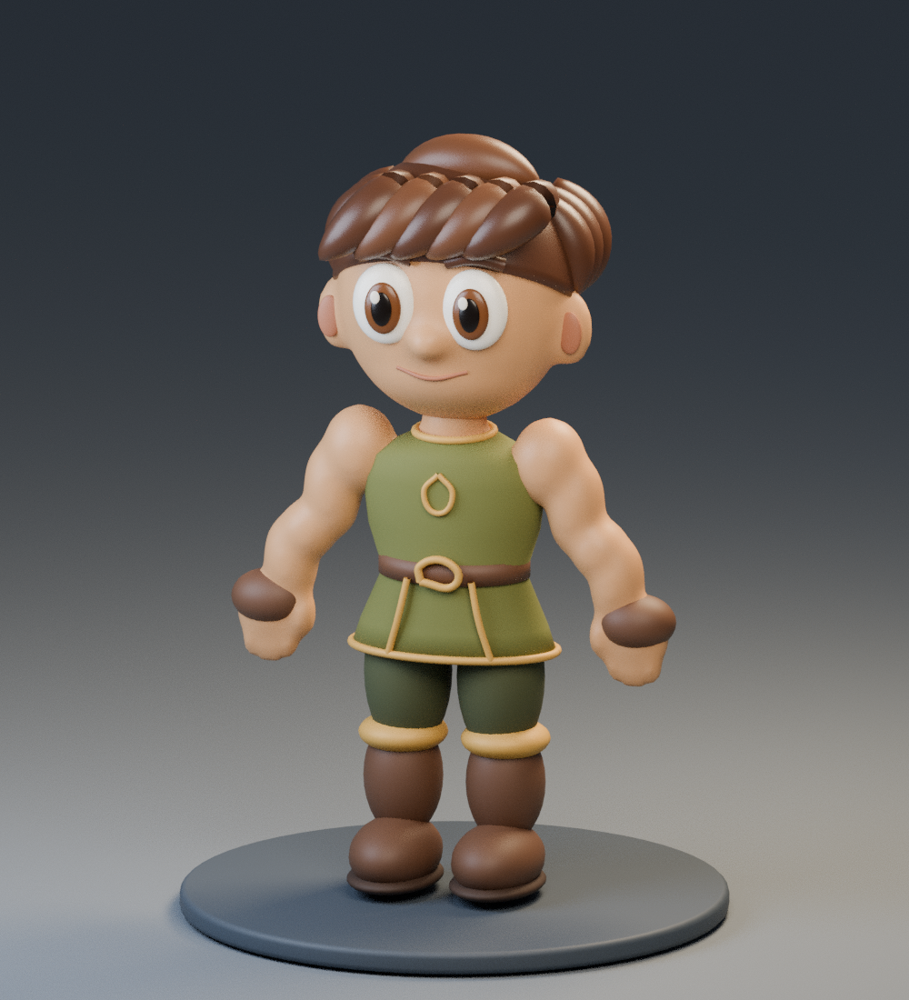

# Corpo-base do Guerreiro

Execute **criar_corpo_base.py**, um arquivo independente do gerador da armadura.
Testado no Blender 4.3.2. Não precisa instalar Python nem baixar bibliotecas.

1. No GitHub, abra o script e use **Download raw file**.
2. No Blender, abra **Scripting**.
3. No Editor de Texto, use **Text → Open…** e abra `criar_corpo_base.py`.
4. Com o mouse sobre o código, pressione **Alt + P**.
5. Volte a **Layout** e salve como `MUBlox_Corpo_Base.blend`.

O script cria uma cena nova, preservando os objetos anteriores. Executar outra
vez cria outra versão independente. Ele não salva arquivos automaticamente.



## Organização

Coleções separadas para corpo, rosto, cabelo, túnica, calças, luvas e botas.
Use os olhos no Outliner para ocultar os grupos. A coleção de apresentação
contém pedestal, câmera e luzes; não faz parte do personagem para exportação.

É uma aproximação procedural do conceito aprovado, com cabeça maior e corpo
compacto. O rosto e o cabelo são uma primeira interpretação 3D, não uma conversão
automática da imagem. O corpo possui volumes unidos por voxel remesh; roupas,
cabelo e elementos faciais são independentes. Ainda exige revisão de anatomia,
interseções e acabamento. A túnica é uma representação simplificada.

**Ainda não é um avatar pronto para o Roblox:** não há rig, animações, UV,
retopologia para deformação nem escala ajustada ao R15. Antes da integração,
precisaremos otimizar a malha, preparar articulações, revisar a roupa e encaixar
os equipamentos. Ocultar a roupa permite estudar o corpo, mas a visibilidade
das partes cobertas ainda não está implementada no jogo.

O gerador antigo `criar_guerreiro.py` continua disponível como estudo do set.
Não substitua scripts Luau nem execute este Python dentro do Roblox Studio.

Verificação de geração repetida e preservação das cenas (na raiz do projeto):

```sh
blender --background --factory-startup --python-exit-code 1 --python tests/check_blender_body.py
```

Esse teste verifica organização e geração. Não valida deformação, desempenho
no Roblox ou fidelidade à imagem conceitual.
