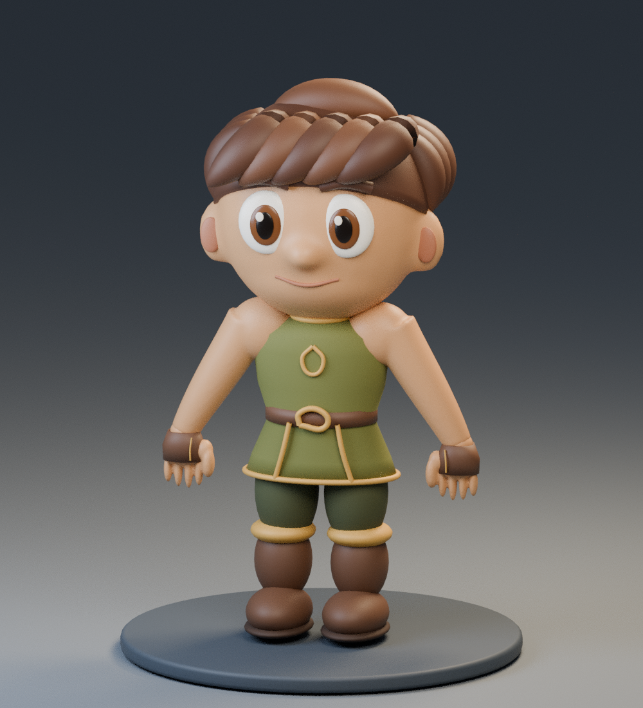

# Estudo do guerreiro a partir da referência

Abra [MUBlox_Estudo_Referencia.blend](MUBlox_Estudo_Referencia.blend) no Blender
por **Arquivo → Abrir**. No GitHub, use o botão de download do arquivo antes
de abrir. O arquivo já contém o modelo, os materiais, as luzes e a câmera.
Selecione a cena `MUBlox_Estudo_Referencia`, caso outra cena esteja ativa.

Este estudo aumenta a cabeça, encurta as pernas e substitui os volumes
empilhados dos braços por uma superfície mais contínua, unida aos ombros e ao
tórax. Mantém roupa inicial e cabelo separados. Ainda não reproduz fielmente
o rosto, as mechas, as mãos e os detalhes da roupa da referência.

É uma etapa de modelagem, **sem rig, pesos de deformação ou UV final**.
Não substitua o FBX do jogo por este arquivo. A malha remesh precisa de
retopologia e preparação para animação antes da integração. O Rojo e o
personagem jogável existente não foram alterados por este estudo.

Para reproduzir, mantenha `estudo_referencia.py` e `criar_corpo_base.py` na
mesma pasta e execute o primeiro no Blender 4.3.2. Para abrir o `.blend`
pronto, não é necessário executar nenhum script.

Validação: geração e renderização no Blender 4.3.2; inspeção visual da prévia.
Ainda não testado como avatar no Roblox.
