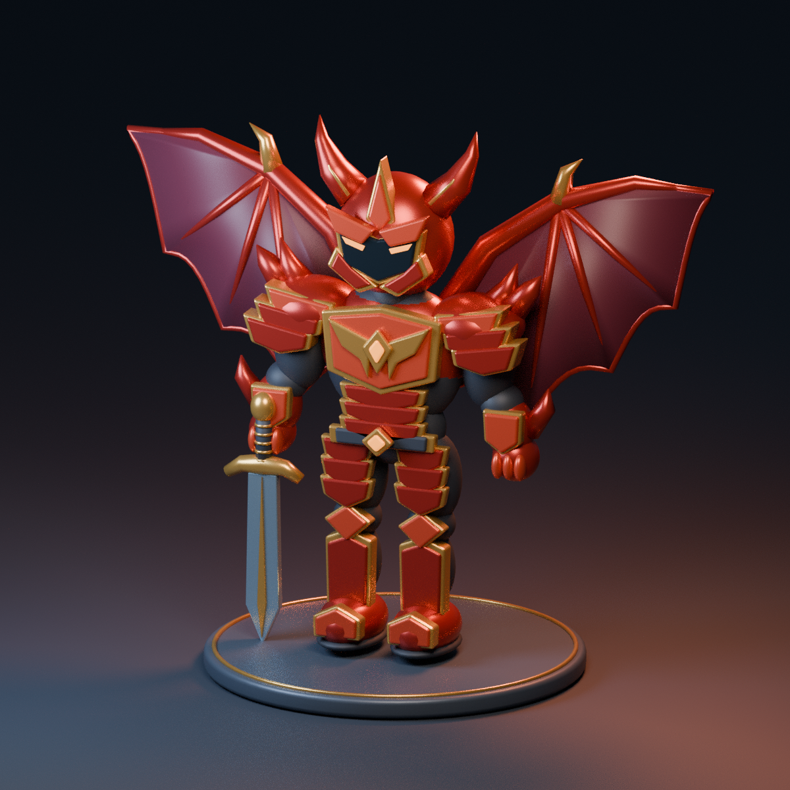

# Guerreiro — base visual no Blender

Novo: [estudo de proporções da referência, com arquivo `.blend` pronto](ESTUDO_REFERENCIA.md).

**Para o personagem sem armadura, use o novo [corpo-base](CORPO_BASE.md).**
Este documento abaixo descreve o estudo anterior do set vermelho.

Este gerador cria um estudo tridimensional do Guerreiro Rubro: proporções
compactas, corpo arredondado, armadura vermelha e dourada, elmo com chifres,
espada e asas de morcego. A prévia foi renderizada a partir do próprio modelo,
não é uma imagem conceitual separada.



## Como executar (sem instalar Python)

1. Baixe `criar_guerreiro.py` pelo botão **Download raw file** no GitHub.
   O arquivo deve terminar em `.py`, não em `.html` ou `.txt`.
2. Abra o Blender. Na parte superior, clique na área de trabalho **Scripting**.
   Se ela estiver fora da tela, role horizontalmente a faixa de abas.
3. No **Editor de Texto**, use **Text → Open…** (Texto → Abrir) e selecione o
   arquivo baixado. Não use o menu geral Arquivo → Abrir, que espera um `.blend`.
4. Clique no triângulo **Run Script** do Editor de Texto. Também pode pressionar
   **Alt + P** com o mouse sobre o código.
5. Volte à aba **Layout**. A nova cena se chama `MUBlox_Guerreiro_Base`.
   A cena anterior permanece disponível no seletor de cenas no topo.
6. Use **Arquivo → Salvar como…** e escolha `MUBlox_Guerreiro.blend`.
   Escolha um nome novo caso queira preservar um arquivo já salvo.

Não cole este Python na barra de comandos do Roblox. Ele roda somente no Blender.
O Rojo não sincroniza modelos do Blender automaticamente.

O script não apaga objetos existentes, não baixa dependências, não usa rede e não
salva arquivos por conta própria. Executá-lo outra vez cria uma nova cena e uma
nova versão independente do modelo. Evite executar muitas vezes sem necessidade.

## Inspeção e ajustes

- Arraste com o botão central do mouse para girar; use a roda para aproximar.
- No painel de objetos (Outliner), cada coleção pode ser ocultada com o ícone de
  olho. Abra `08_Wings_Asas` para ver as duas asas separadamente.
- As coleções `01` a `08` contêm o modelo. `09_Apresentacao_Nao_Exportar` contém
  pedestal, chão, luzes e câmera; não exporte essa coleção para o jogo.
- `02_Helmet_Elmo`, `03_Armor_Peito_Ombros`, `04_Gloves_Luvas`,
  `05_Pants_Calcas`, `06_Boots_Botas`, `07_Sword_Espada`, `08_Wings_Asas`
  correspondem às partes do inventário. Os objetos Empty de cada grupo possuem
  o atributo `equipment_slot`. Isso é organização, ainda não uma integração.
- No início do script você pode mudar `CRIAR_ASAS`, `CRIAR_ESPADA` e as cores.
  O modo Solid já exibe as cores dos materiais. Para ver metal e iluminação,
  use Material Preview, Rendered ou **F12** (renderização pode demorar).

## Estágio atual

Validado executando o script no Blender **4.3.2**. Usa APIs padrão da série 4.x;
outras versões ainda não foram executadas neste ambiente.

É uma **base visual modular**, não um avatar pronto para importar. Ainda não tem
rig, animações, UV, texturas assadas ou encaixe calibrado para um corpo R15.
As peças usam materiais separados e modificadores editáveis. O corpo e a
armadura são montados de várias malhas; não são uma superfície contínua pronta
para deformar. A espada está em pose de apresentação.

Próximos passos: aprovar silhueta e proporções, ajustar sobre um R15 exportado do
Studio, separar as peças por articulação, simplificar/juntar malhas, preparar
UV e materiais exportáveis, posicionar pivôs, adaptar rig e testar importação,
equipamento e animações no Roblox. O brilho e a iluminação do render precisarão
ser configurados também no Studio.

## Reprodução da prévia

Na raiz do repositório, com Blender no PATH:

```sh
blender --background --factory-startup --python-exit-code 1 \
  --python art/blender/criar_guerreiro.py \
  --python-expr "import bpy; bpy.context.scene.render.filepath='//art/previews/guerreiro_base.png'; bpy.ops.render.render(write_still=True)"
```

Para verificar geração repetida, preservação da cena anterior e geometria:

```sh
blender --background --factory-startup --python-exit-code 1 \
  --python tests/check_blender_model.py
```
